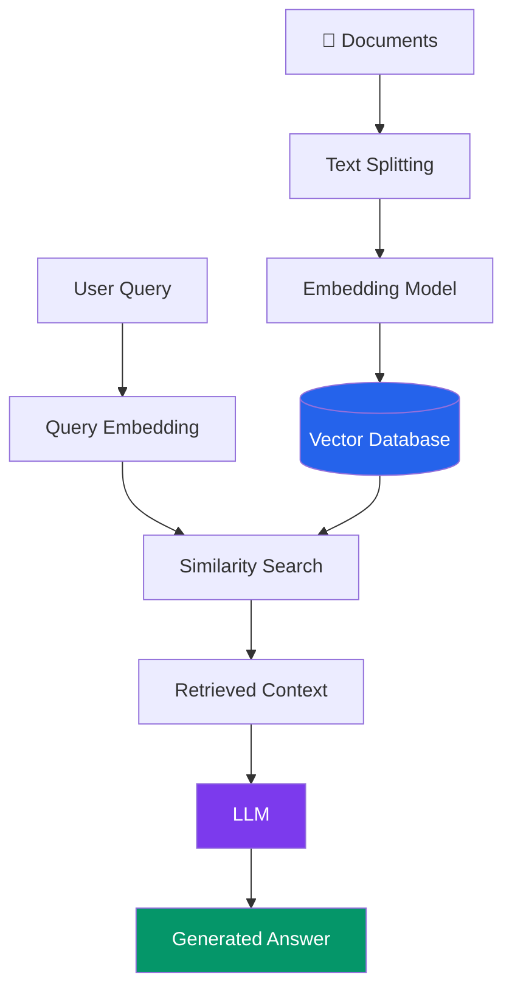
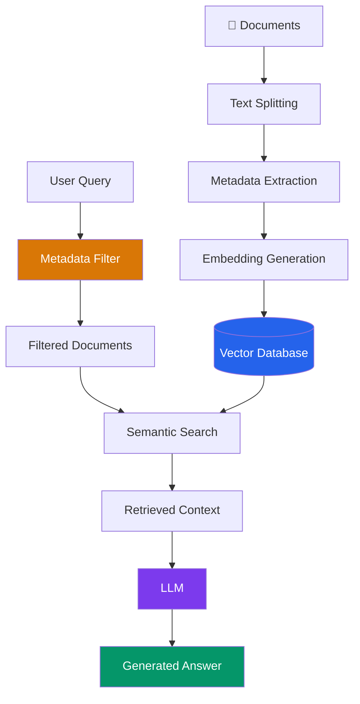
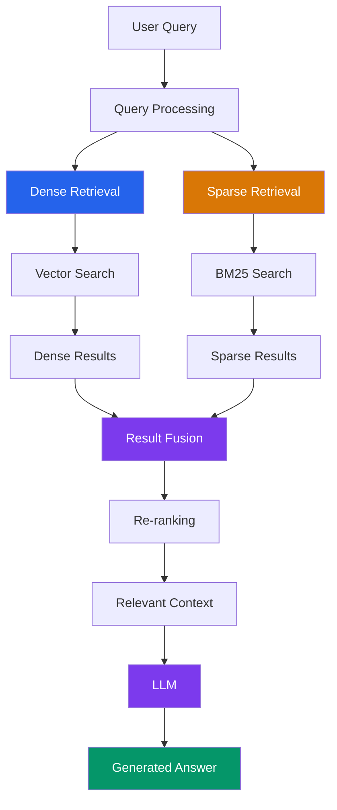

# 🧠 RAG Lab — Exploring Retrieval-Augmented Generation

<p align="center">
  
  
  
  
</p>

<p align="center">
  <b>A hands-on exploration of different Retrieval-Augmented Generation architectures.</b>
  <br/>
  From traditional semantic retrieval to metadata-aware and hybrid search strategies.
</p>

---

## 📌 Overview

This repository explores three different approaches to **Retrieval-Augmented Generation (RAG)**.

Instead of relying entirely on an LLM's pre-trained knowledge, RAG retrieves relevant information from an external knowledge source and uses it to generate context-aware responses.

The objective of this repository is to understand how different retrieval strategies affect the relevance, accuracy, and quality of generated responses.

### 🔍 Implementations

| Architecture | Approach | Key Idea |
|:---|:---|:---|
| 🟢 Normal RAG | Semantic Search | Retrieve relevant chunks using embeddings |
| 🔵 Metadata RAG | Metadata Filtering + Retrieval | Use document attributes to narrow retrieval |
| 🟣 Hybrid RAG | Combined Retrieval | Combine semantic and keyword-based search |

---

## 🏗️ Architecture Overview

### 1. Normal RAG

The traditional RAG pipeline.

Documents are divided into smaller chunks, converted into embeddings, and stored in a vector database. When a user asks a question, the system retrieves semantically similar chunks and passes them to the LLM.



**Workflow:**
1. Load documents.
2. Split documents into chunks.
3. Generate embeddings.
4. Store embeddings in a vector database.
5. Convert the user query into an embedding.
6. Retrieve the most similar chunks.
7. Pass retrieved context to the LLM.
8. Generate the final response.

**Key takeaway:** Retrieval is based primarily on semantic similarity.

---

### 2. Metadata RAG

Metadata RAG introduces additional information about documents and their individual chunks.

Instead of searching through the entire knowledge base, the system can use metadata to filter relevant information before or during retrieval.

Examples of metadata:

- Document name
- Author
- Category
- Creation date
- Source
- Department
- Document type



**Example:**

Imagine a knowledge base containing research papers from multiple domains.

A user asks:

"Find research papers related to cancer detection published after 2020."

The system can use metadata filters such as:

```python
{
    "category": "Healthcare",
    "year": {"$gte": 2021}
}
```

It can then perform semantic retrieval within the filtered collection.

**Key takeaway:** Metadata adds structured control over the retrieval process.

---

### 3. Hybrid RAG

Hybrid RAG combines two retrieval techniques:

- **Dense Retrieval:** Uses embeddings to understand semantic meaning.
- **Sparse Retrieval:** Uses keyword-based matching, such as BM25, to identify exact terms.

This combination helps address situations where semantic similarity alone may not be sufficient.



**Example:**

Consider the query:

"What are the side effects of Metformin?"

- Dense retrieval can identify documents discussing diabetes medication effects, even if the exact wording differs.
- Sparse retrieval can identify documents containing the exact term "Metformin".
- Result fusion combines both retrieval outputs.
- Re-ranking can further prioritize the most relevant results.

**Key takeaway:** Hybrid retrieval combines semantic understanding with exact keyword matching.

---

## ⚖️ Comparing the Three Approaches

| Feature | Normal RAG | Metadata RAG | Hybrid RAG |
|:---|:---:|:---:|:---:|
| Semantic Search | ✅ | ✅ | ✅ |
| Metadata Filtering | ❌ | ✅ | Optional |
| Keyword Search | ❌ | ❌ | ✅ |
| Vector Database | ✅ | ✅ | ✅ |
| BM25 | ❌ | ❌ | ✅ |
| Result Fusion | ❌ | ❌ | ✅ |
| Re-ranking | Optional | Optional | Optional |

> Note: These architectures are not mutually exclusive. Metadata filtering can also be integrated into a hybrid retrieval pipeline.

---

## 🎯 What This Repository Explores

The main goal is to understand the practical differences between retrieval strategies.

Some questions explored through these implementations:

- How does chunk size affect retrieval quality?
- How does embedding similarity influence the retrieved context?
- Does metadata filtering improve retrieval precision?
- How does BM25 complement semantic search?
- Does combining sparse and dense retrieval improve relevance?
- How does re-ranking affect the final context?
- How do different retrieval approaches affect LLM responses?

---

## 📂 Project Structure

```text
RAG/
│
├── Normal_RAG/
│   ├── data/
│   ├── notebooks/
│   └── ...
│
├── Metadata_RAG/
│   ├── data/
│   ├── notebooks/
│   └── ...
│
├── Hybrid_RAG/
│   ├── data/
│   ├── notebooks/
│   └── ...
│
├── requirements.txt
└── README.md
```

*The directory structure above is illustrative. Adjust it to match the actual repository.*

---

## 🚀 Getting Started

### 1. Clone the repository

```bash
git clone https://github.com/YOUR_USERNAME/YOUR_REPOSITORY.git
cd YOUR_REPOSITORY
```

### 2. Create a virtual environment

```bash
python -m venv venv
```

Activate it:

**Windows**
```bash
venv\Scripts\activate
```

**Linux / macOS**
```bash
source venv/bin/activate
```

### 3. Install dependencies

```bash
pip install -r requirements.txt
```

### 4. Explore the implementations

Start with the following order:

1. `Normal_RAG` — Understand the fundamentals.
2. `Metadata_RAG` — Explore structured retrieval.
3. `Hybrid_RAG` — Understand combined retrieval strategies.

---

## 🧰 Technologies

The following are the core technology categories involved in these implementations. The exact libraries depend on the implementation.

| Component | Purpose |
|:---|:---|
| Python | Core development |
| Embedding Models | Text-to-vector conversion |
| Vector Database | Embedding storage and similarity search |
| LLM | Context-aware answer generation |
| BM25 | Keyword-based retrieval |
| Re-ranking Models | Improve retrieved result ordering |

---

## 🛣️ Future Scope

- [ ] Implement document-level and chunk-level metadata filtering.
- [ ] Experiment with different embedding models.
- [ ] Compare different chunking strategies.
- [ ] Implement BM25-based sparse retrieval.
- [ ] Experiment with Reciprocal Rank Fusion (RRF).
- [ ] Introduce cross-encoder re-ranking.
- [ ] Evaluate retrieval using Precision@K, Recall@K and MRR.
- [ ] Evaluate answer quality using faithfulness and answer relevance.
- [ ] Experiment with query expansion and multi-query retrieval.
- [ ] Build a unified interface to compare all three RAG pipelines.

---

## 💡 Final Thoughts

RAG is not just about connecting an LLM to a vector database.

The retrieval strategy plays a significant role in determining what information reaches the LLM and ultimately influences the quality of its response.

This repository is an attempt to explore that layer in depth — understanding not just how RAG works, but how different retrieval architectures can make it better.

<p align="center">
  <b>Learn. Experiment. Retrieve. Improve.</b>
  <br/>
  <sub>Built while exploring the world of Retrieval-Augmented Generation.</sub>
</p>
